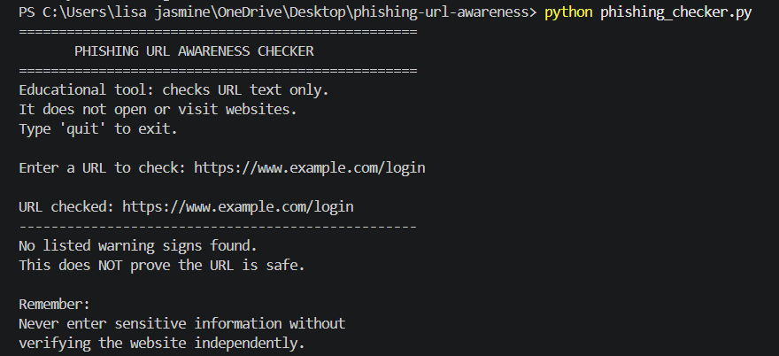
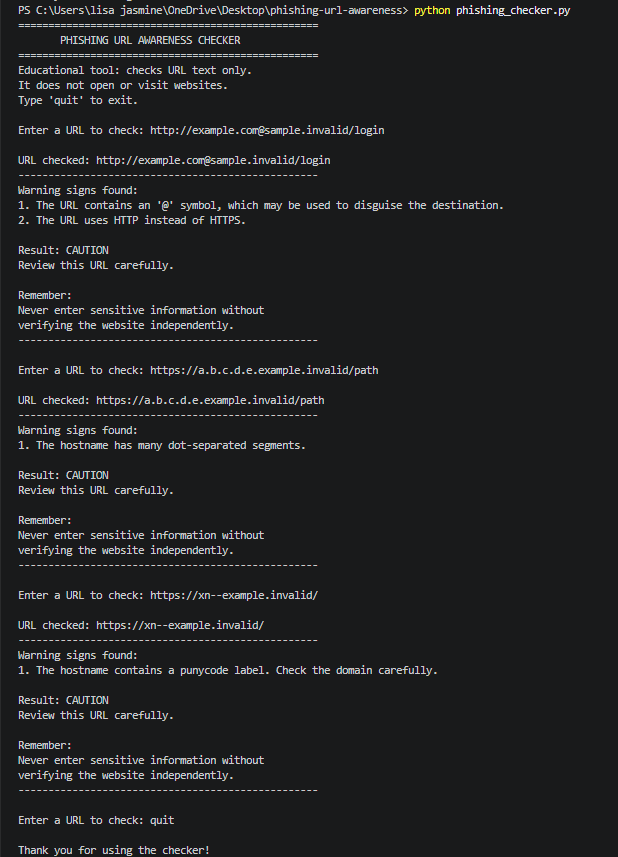

# Phishing URL Awareness Checker

## 1. Project Overview

The Phishing URL Awareness Checker is a beginner-friendly cybersecurity project developed using Python. It examines a URL's text and identifies common warning signs that may indicate a suspicious link.

The purpose of this project is to help users become more aware of phishing risks and understand why they should examine links carefully.

**Important:** This tool does not confirm whether a URL is safe or malicious. It only checks for specific warning signs.

## 2. Features

The program checks for six warning signs:

1. **@ Symbol:** Identifies URLs containing an `@` symbol.
2. **Unusually Long URL:** Flags URLs longer than 100 characters.
3. **IP Address Hostname:** Identifies hostnames formatted as IPv4 addresses.
4. **Many Hostname Segments:** Flags hostnames containing five or more dot-separated segments.
5. **Punycode:** Identifies hostname labels beginning with `xn--`.
6. **HTTP Scheme:** Warns when a URL uses HTTP instead of HTTPS.

Other features include:
- Checking multiple URLs in one session.
- Displaying warning messages in plain language.
- Handling empty input.
- Allowing the user to exit by entering `quit`.
- Reminding users that the absence of warning signs does not guarantee safety.

## 3. Technologies Used

- Python 3.10 or later
- Visual Studio Code
- Python standard-library modules:
  - `re`
  - `urllib.parse`

No external Python packages are required.

## 4. How to Run the Project

### Requirements

Install Python 3.10 or later and use a terminal or a code editor such as Visual Studio Code.

### Steps

1. Download or clone this repository.
2. Open the project folder in VS Code.
3. Open a terminal in the project folder.
4. Run the following command:

```bash
python phishing_checker.py
```

5. Enter a URL when prompted.
6. Review the warning signs displayed by the program.
7. Enter another URL to continue checking, or type `quit` to exit.

## 5. Example Output

For the sample input:

```text
https://www.example.com/login
```

The program displays:

```text
No listed warning signs found.
This does NOT prove the URL is safe.
```

For a URL containing an IP address and HTTP:

```text
http://192.0.2.10/account
```

The program identifies the IP address hostname and HTTP scheme as warning signs.

## 6. Testing

The program was tested using five sample URLs.

| Test | Purpose | Expected Result |
|---|---|---|
| 1 | Normal example URL | No listed warning signs |
| 2 | IP address and HTTP | IP address and HTTP warnings |
| 3 | @ symbol and HTTP | @ symbol and HTTP warnings |
| 4 | Many hostname segments | Hostname segments warning |
| 5 | Punycode hostname | Punycode warning |

Detailed test inputs, expected results, actual results, and status are documented in [`tests/test_samples.md`](tests/test_samples.md).

## 7. Screenshots

### Sample Run

This screenshot demonstrates the program checking a sample URL.



### Test Results

This screenshot demonstrates the program identifying warning signs in sample URLs.



## 8. Improvements Implemented

### Improvement 1: Multiple-URL Checking

The program uses a loop to allow users to check multiple URLs without restarting the application after every check.

**Benefit:** Makes the tool more convenient to use.

### Improvement 2: Clearer Warning Messages

The program explains detected warning signs in plain language and displays a caution message when warnings are found.

**Benefit:** Helps users understand why a URL should be reviewed carefully.

Additional input handling allows the program to respond to empty input and catch `ValueError` exceptions.

## 9. Limitations

- The program examines URL text only.
- It does not visit websites or send requests.
- It does not scan for malware.
- It does not check website reputation or consult external threat-intelligence services.
- It can miss phishing URLs that do not contain any of the six listed warning signs.
- A URL using HTTPS is not necessarily trustworthy.
- A URL with no listed warning signs is not guaranteed to be safe.

## 10. Ethical Use

This project is intended for cybersecurity awareness and educational purposes.

- Use sample URLs for testing.
- Do not collect passwords or other sensitive information.
- Do not use the project to deceive people.
- Do not test websites without appropriate permission.
- Verify suspicious links independently instead of relying only on this tool.

## 11. Conclusion

This project demonstrates how Python functions, conditional statements, strings, regular expressions, and URL parsing can be used to identify common phishing warning signs.

It also demonstrates basic software testing, documentation, and project organization using GitHub.

The project is an educational aid and should not be treated as a complete phishing detection system.

## 12. Author

**Author:** Lishajasmine Thangavel

**Batch:** B 1
